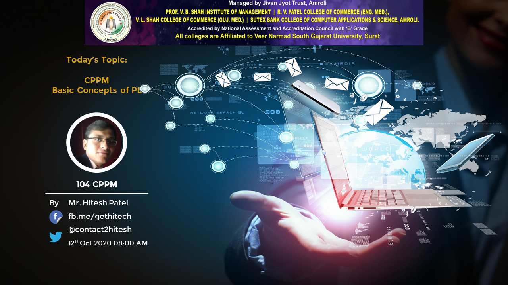
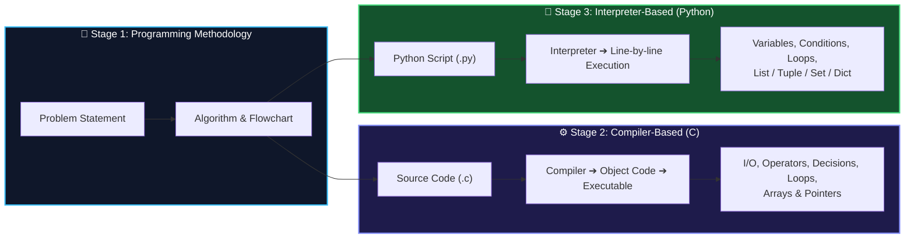

<div align="center">



# 🧩 104: Programming Concepts & Programming Methodology (PCPM)

### *From Algorithms & Flowcharts to Compiled C and Interpreted Python*

[](https://www.vnsgu.ac.in/)
[](https://www.education.gov.in/)
[](https://en.cppreference.com/w/c)
[](https://gcc.gnu.org/)
[](https://www.python.org/)
[](https://code.visualstudio.com/)

<p align="center">
  <b>Department of Computer Science & Data Science</b><br>
  <b>Sutex Bank College of Computer Applications and Science (SBCCAS)</b><br>
  <i>Affiliated with Veer Narmad South Gujarat University (VNSGU), Surat, Gujarat, India</i>
</p>

[📘 Syllabus](1_Syllabus/) • [📝 Lecture Notes](2_Lecture_Notes/) • [🚀 Programs](3_Projects_Presentations/) • [📂 Assignments](4_Assignments/) • [💡 Question Bank](5_QuestionBank/) • [📚 eBooks](6_eBooks_ExtraResources/) • [📄 Past Papers](7_Previous_Year_Papers/)

---

</div>

## 🌌 Course Architecture: From Problem to Program

Every program begins as a **problem** and an **algorithm** long before it becomes code. This course builds that methodology first, then implements it twice: in **C**, a compiler-based structured language, and in **Python**, an interpreter-based language — so students understand *how* languages execute, not just *what* to type. This repository houses the syllabus, lecture notes, sample programs, assignments, and question banks for **104 PCPM**.



---

## 🎯 Course Outcomes (CO Matrix)

Upon successful completion of this syllabus, students achieve mastery across five primary dimensions:

| ID | Course Outcome (CO) | Key Competency | Tools & Concepts |
| :--- | :--- | :--- | :--- |
| **CO1** | Learn the fundamental programming concepts of **compiler-based and interpreter-based** programming languages. | Language Execution Models | Compiler, Interpreter |
| **CO2** | Work proficiently with **conditional statements, iterative statements** and programming fundamentals using C and Python. | Control Flow & Logic Building | `if`, `switch`, `for`, `while` |
| **CO3** | Represent compound data using **lists, tuples and dictionaries** in Python programs. | Data Structuring | `list`, `tuple`, `set`, `dict` |
| **CO4** | Learn **programming methodology** — algorithms, flowcharts and structured problem solving. | Problem Solving & Design | Algorithms, Flowcharts |
| **CO5** | Understand an **interpreter-based language (Python)** and compare it with the C programming language. | Comparative Programming | C vs Python |

---

## 📑 Syllabus Breakdown: 5 Units

> ℹ️ **Note on handout numbering:** The C lecture handouts (`104_CPPM_Unit_*.pdf`) were originally prepared for the BCA CPPM syllabus, where decisions and loops were separate units. The links below map each handout to the correct **PCPM** unit.

<details open>
<summary><h3>🧭 Unit 1: Introduction to Programming Concepts</h3></summary>

* **Programming Languages & Methodology**:
  * Source code, object code and executable code.
  * Algorithms and flowcharts; concepts of structured programming.
* **Compiler vs Interpreter**:
  * Introduction and comparison of compiler-based and interpreter-based languages.
  * Program body structure in **C** and in **Python**.
  * Character set, variables, constants, identifiers, literals and keywords in C and Python.
  * Data types in C (signed / unsigned `int`, `short`, `long`, `float`, `double`, `char`, `void`) and primitive data types in Python.

```c
/* Basic structure of a C program */
#include <stdio.h>          /* Pre-processor directive  */

int main()                  /* Execution starts here    */
{
    printf("Hello, PCPM!\n");
    return 0;
}
```

👉 **Notes:** [Unit-1 Handout](2_Lecture_Notes/104_CPPM_Unit_1.pdf) • [Unit-1 Handout V2](2_Lecture_Notes/104_CPPM_Unit_1_V2.pdf) • [Basic Structure of C Programs](2_Lecture_Notes/Basic_Structure_of_C_Programs.jpg)
</details>

<details open>
<summary><h3>⌨️ Unit 2: Input/Output Statements and Operators (C)</h3></summary>

* **Header Files & Pre-processor**:
  * Concepts of header files (`stdio.h`, `conio.h`); pre-compiler directives `#include` and `#define`.
* **Input / Output Statements**:
  * Input: `scanf()`, `getc()`, `getch()`, `gets()`, `getchar()`.
  * Output: `printf()`, `putc()`, `puts()`, `putchar()`.
  * Format specifiers: `%d`, `%ld`, `%f`, `%c`, `%s`, `%lf`.
* **Operators**:
  * Arithmetic, logical, relational, bit-wise and assignment operators.
  * Ternary operator and the `sizeof()` operator.
* **Built-in Functions**:
  * String: `strlen`, `strcmp`, `strcpy`, `strcat`, `strrev`.
  * Math: `abs()`, `floor()`, `round()`, `ceil()`, `sqrt()`, `exp()`, `log()`, `sin()`, `cos()`, `tan()`, `pow()`, `trunc()`.

```c
#include <stdio.h>
#define PI 3.14

int main()
{
    float r, area;
    printf("Enter radius: ");
    scanf("%f", &r);
    area = PI * r * r;
    printf("Area of circle = %.2f\n", area);
    printf("Size of float  = %d bytes\n", (int) sizeof(float));
    return 0;
}
```

👉 **Notes:** [Unit-2 Handout](2_Lecture_Notes/104_CPPM_Unit_2.pdf) • [Unit-2 Handout V2](2_Lecture_Notes/104_CPPM_Unit_2_V2.pdf)
</details>

<details open>
<summary><h3>🔀 Unit 3: Decision Making and Iterative Statements (C)</h3></summary>

* **Decision Making**:
  * Simple `if`, `if…else`, `if…else if…else`, and nested `if`.
  * `switch…case` with `break` and `default`; difference between `switch` and `if`.
* **Iteration**:
  * Use of `goto` for iteration; `while`, `do…while` and `for` loops.
  * Nested `while`, `do…while` and `for` loops (pattern programs).
  * Jumping statements: `break` and `continue`.

```c
#include <stdio.h>

int main()
{
    int i, j, n = 5;
    for (i = 1; i <= n; i++)        /* rows    */
    {
        for (j = 1; j <= i; j++)    /* columns */
            printf("* ");
        printf("\n");
    }
    return 0;
}
```

👉 **Notes:** [Decision Making Handout](2_Lecture_Notes/104_CPPM_Unit_3.pdf) • [Decision Making Handout V2](2_Lecture_Notes/104_CPPM_Unit_3_V2.pdf) • [Iterative Statements Handout](2_Lecture_Notes/104_CPPM_Unit_4.pdf)
</details>

<details open>
<summary><h3>🧮 Unit 4: Arrays and Pointers (C)</h3></summary>

* **Single-dimensional Arrays**:
  * Numeric 1-D arrays; sorting in ascending / descending order (**Bubble** and **Selection** sort).
  * Searching an element (**Linear Search**).
  * Character 1-D arrays; use of `\0`, `\n` and `\t`.
* **Pointers**:
  * Concepts of pointers; declaring and initializing `int`, `float`, `char` and `void` pointers.
  * Pointer to a single-dimensional numeric array.

```c
#include <stdio.h>

int main()
{
    int a[5] = {10, 20, 30, 40, 50};
    int *p = a, i, sum = 0;

    for (i = 0; i < 5; i++)
        sum += *(p + i);            /* pointer arithmetic */

    printf("Sum = %d\n", sum);
    return 0;
}
```

👉 **Notes:** [Arrays & Pointers Handout](2_Lecture_Notes/104_CPPM_Unit_5.pdf) • [Bubble Sort Algorithm](2_Lecture_Notes/Bubble_Sort_Algorithm.pdf) • [Selection Sort Algorithm](2_Lecture_Notes/Selection_Sort_Algorithm.pdf) • [Pointer to Pointer](2_Lecture_Notes/pointer_to_pointer.jpg)
</details>

<details open>
<summary><h3>🐍 Unit 5: Interpreter-Based Programming using Python</h3></summary>

* **Getting Started**:
  * Concepts of an interpreter language; starting with Python code.
  * Variables, data structures, data types and data conversion.
* **Conditional & Iterative Statements**:
  * `if`, `elif`, `else`; `for` and `while` loops; Python operators.
* **In-built Collections**:
  * List, Tuple, Set and Dictionary.

```python
# The same pattern program from Unit 3 — now in Python
n = 5
for i in range(1, n + 1):
    print("* " * i)

# Python collections at a glance
marks = [78, 85, 92]                 # list  (mutable)
point = (3, 4)                       # tuple (immutable)
langs = {"C", "Python"}              # set   (unique items)
student = {"name": "Asha", "sem": 1} # dict  (key: value)
```

👉 **Notes:** [Python Basics](2_Lecture_Notes/104_PCPM_Unit_5_1_Python_Basics.pdf) • [Iterative Statements](2_Lecture_Notes/104_PCPM_Unit_5_2_1_Python_Iterative_Statements.pdf) • [Strings & Operators](2_Lecture_Notes/104_PCPM_Unit_5_2_3_Python_Strings_and_Operators.pdf) • [Python Collections](2_Lecture_Notes/104_PCPM_Unit_5_3_Python_Collections.pdf)
</details>

> 🧪 **Practical work:** Units 1–4 are carried out in the **C** programming language and Unit 5 in **Python**.

---

## 🗂️ Repository Structure Blueprint

```text
Programming-Concepts-and-Programming-Methodology/
│
├── 📂 1_Syllabus/                       # Official University syllabus
│   └── 104-Programming Concepts and Programming Methodology (PCPM).pdf
│
├── 📂 2_Lecture_Notes/                  # Unit-wise handouts & diagrams (C + Python)
│   ├── 104_CPPM_Unit_1.pdf … 104_CPPM_Unit_5.pdf
│   ├── 104_PCPM_Unit_5_*_Python_*.pdf
│   └── Bubble_Sort_Algorithm.pdf, Selection_Sort_Algorithm.pdf
│
├── 📂 3_Projects_Presentations/         # C lab programs demonstrated in class
│   └── mix/                             # Additional practice programs
│
├── 📂 4_Assignments/                    # Theory & practical assignment sheets
│   ├── 104_PCPM_BScDS_ASS_I_II_III_IV_2026-27.pdf
│   ├── 104_PCPM_BScDSA_ASS_I_II_III_IV_2024-25.pdf
│   ├── 104_PCPM_Practical_Assignment_Sheet.pdf
│   └── 104_PCPM_Pattern_Programs_in_C.pdf
│
├── 📂 5_QuestionBank/                   # Unit-wise MCQ banks
│   └── 104_CPPM_All_Units_MCQs.pdf
│
├── 📂 6_eBooks_ExtraResources/          # Tutorials, cheat sheets & reference material
│
├── 📂 7_Previous_Year_Papers/           # University examination papers & QR archives
│   └── BCA Old Papers QR.pdf
│
└── 📂 assets/                           # README banner & images
```

---

## 🧪 Quickstart Lab Environment Setup

### Option 1: Online Compilers (no installation)
Practise instantly in the browser:
[](https://www.onlinegdb.com/)
[](https://colab.research.google.com)

### Option 2: Local Environment (Windows)

```bash
# 1. Clone repository
git clone https://github.com/sbccas/Programming-Concepts-and-Programming-Methodology.git
cd Programming-Concepts-and-Programming-Methodology

# 2. Install a C compiler (MinGW-w64 GCC) and Python 3, then verify
gcc --version
python --version

# 3. Compile & run a C program
gcc 3_Projects_Presentations/HELLO.C -o hello
./hello

# 4. Run a Python program
python your_program.py
```

> 💡 Recommended editor: **VS Code** with the *C/C++* and *Python* extensions. See the [VS Code keyboard shortcuts](6_eBooks_ExtraResources/VS%20Code%20-keyboard-shortcuts-windows.pdf).

---

## 🔮 A Pinch of AI: Student Copilot Cheat Sheet

As future Data Scientists, use AI to *understand*, not to copy:

<div align="center">

| Objective | Recommended Prompt Template for Student LLM Assistants |
| :--- | :--- |
| **Algorithm → Flowchart** | *"Write a step-by-step algorithm and describe the flowchart symbols for finding the largest of three numbers. Do not write code yet."* |
| **Debug a C Error** | *"My C program gives the error `[error]` on line [n]. Here is the code: [code]. Explain the cause in simple words and show only the corrected line."* |
| **Dry-Run a Loop** | *"Trace this nested `for` loop step by step in a table showing the values of `i`, `j` and the output: [code]."* |
| **C vs Python** | *"Convert this C program to Python and explain three differences between how the compiler and the interpreter handle it: [code]."* |

</div>

---

## 📖 Recommended Reference Books & Literature

1. **Programming in ANSI C** — *E. Balagurusamy* (TMH)
2. **C: How to Program** — *Deitel & Deitel* (PHI)
3. **The C Programming Language** — *Kernighan & Ritchie* (TMH)
4. **Programming in C** — *Stephen Kochan* (CBS)
5. **Mastering Turbo C** — *Kelly & Bootle* (BPB)
6. **C Language Programming** — *Byron Gottfried* (TMH)
7. **Let Us C** — *Yashavant Kanetkar* (BPB Publications)
8. **Magnifying C** — *Arpita Gopal* (PHI)
9. **Problem Solving with C** — *Somashekara* (PHI)
10. **Programming in C** — *Pradip Dey & Manas Ghosh* (Oxford)
11. **Learning Python** — *Mark Lutz* (O'Reilly, ISBN: `9781449355739`)
12. **Python for Data Analysis** — *Wes McKinney* (O'Reilly, ISBN: `9781491957660`)

---

## 📊 Evaluation & Examination Scheme

| Assessment Type | Components | Weightage |
| :--- | :--- | :---: |
| **Internal Assessment** | Continuous Evaluation, Lab Practicals, Quizzes, Assignments & Attendance | **50%** |
| **External University Exam** | VNSGU End-Semester Theory Examination & Practical Examination | **50%** |

---

## 🤝 Contributing & Academic Integrity

- **For Students**: Contributions through pull requests are welcome! If you find typographical errors, have better solutions to lab programs, or want to add practice problems, feel free to open a PR.
- **Academic Honor Code**: Students must submit original programs for lab exercises and assignments. Generative AI tools may be used for understanding concepts, but every program must be understood and explained by the student during practical and viva examinations.

---

<div align="center">

Made with 💙 for the **B.Sc. Data Science & Analytics** Students  
**Sutex Bank College of Computer Applications and Science (SBCCAS)**  
*Veer Narmad South Gujarat University (VNSGU), Surat*

</div>
